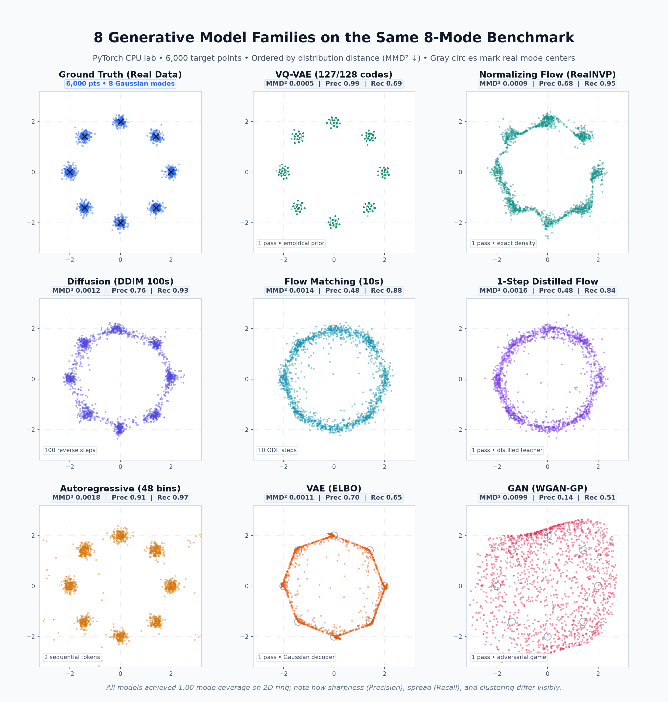
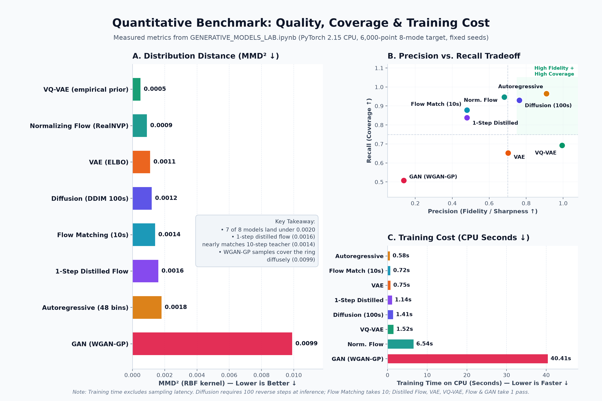
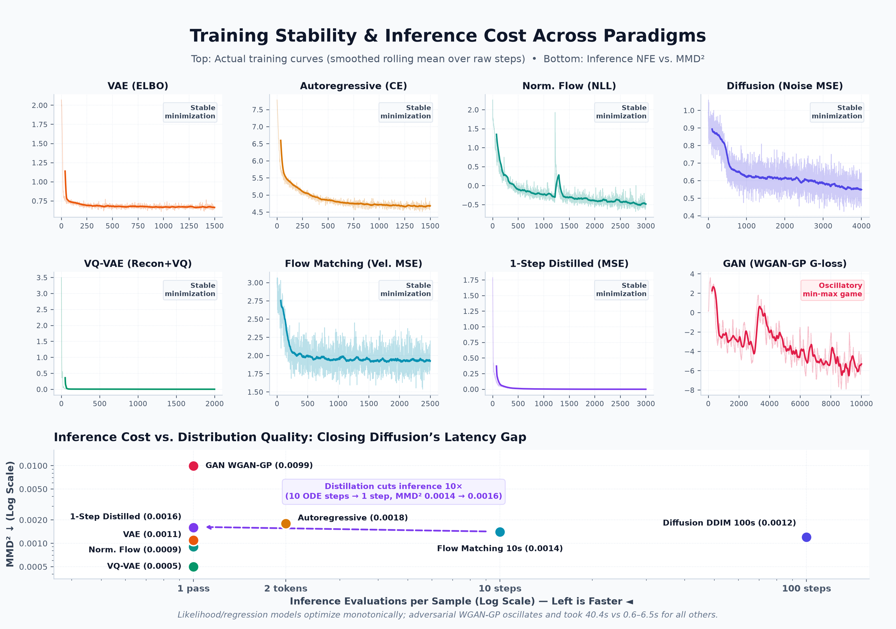
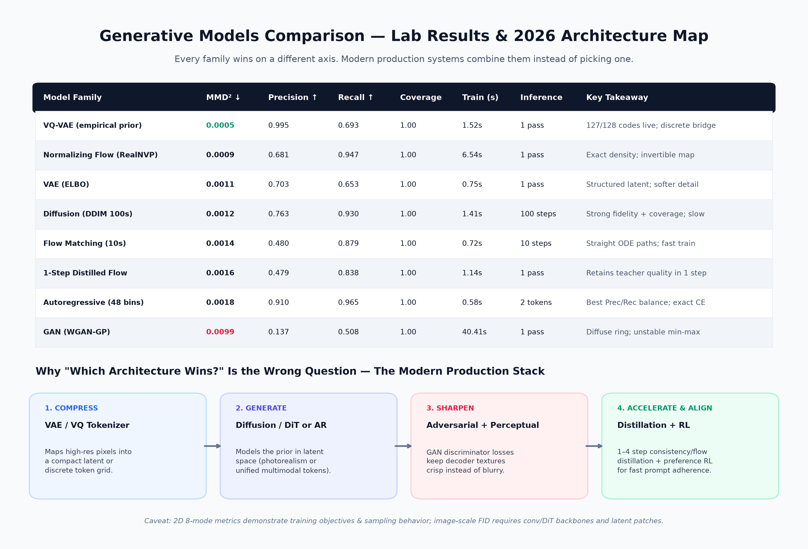

# Generative Models Comparison Lab

A hands-on, side-by-side comparison of **8 generative modeling paradigms** implemented from scratch in PyTorch, trained on the exact same 8-mode 2D Gaussian ring dataset, and evaluated with identical distribution metrics (`MMD²`, `Precision`, `Recall`, `Mode Coverage`, and CPU training time).



## What's Inside

- [`GENERATIVE_MODELS_LAB.ipynb`](GENERATIVE_MODELS_LAB.ipynb) — Executable end-to-end PyTorch notebook implementing all 8 models with 17 embedded plots and zero errors.
- [`RESULTS.md`](RESULTS.md) & [`RESULTS.csv`](RESULTS.csv) — Measured metrics and interpretation across every model.
- [`DEEP_DIVE.md`](DEEP_DIVE.md) — Architectural deep dive covering objectives, strengths, failure modes, and modern hybrid pipelines.
- [`CHEAT_SHEET.md`](CHEAT_SHEET.md) — One-page comparison table, tradeoff triangle, and decision guide.
- [`images/`](images/) — High-resolution summary charts and sample visualizations.

## Measured Results (PyTorch CPU, 6,000-Point 8-Mode Ring)

| Model | MMD² ↓ | Precision ↑ | Recall ↑ | Mode Coverage ↑ | Train Time (s) | Inference Cost |
|---|---:|---:|---:|---:|---:|---|
| **VQ-VAE** *(empirical prior)* | **0.0005** | **0.9947** | 0.6927 | 1.00 | 1.52 | 1 pass |
| **Normalizing Flow** *(RealNVP)* | 0.0009 | 0.6813 | 0.9467 | 1.00 | 6.54 | 1 pass |
| **VAE** *(ELBO)* | 0.0011 | 0.7027 | 0.6527 | 1.00 | 0.75 | 1 pass |
| **Diffusion** *(DDIM 100s)* | 0.0012 | 0.7627 | 0.9300 | 1.00 | 1.41 | 100 steps |
| **Flow Matching** *(10s)* | 0.0014 | 0.4800 | 0.8787 | 1.00 | 0.72 | 10 ODE steps |
| **1-Step Distilled Flow** | 0.0016 | 0.4793 | 0.8380 | 1.00 | 1.14 | 1 pass |
| **Autoregressive** *(48 bins)* | 0.0018 | 0.9100 | **0.9653** | 1.00 | **0.58** | 2 tokens |
| **GAN** *(WGAN-GP)* | 0.0099 | 0.1373 | 0.5080 | 1.00 | 40.41 | 1 pass |

## Visual Analysis







## Quickstart

```bash
pip install torch numpy pandas scikit-learn matplotlib jupyter
jupyter notebook GENERATIVE_MODELS_LAB.ipynb
```

> **Note:** These 2D benchmarks isolate training objectives, convergence stability, and sampling dynamics. Scaling to photorealistic images replaces the toy MLPs with convolutional or DiT backbones operating over latent patches.
